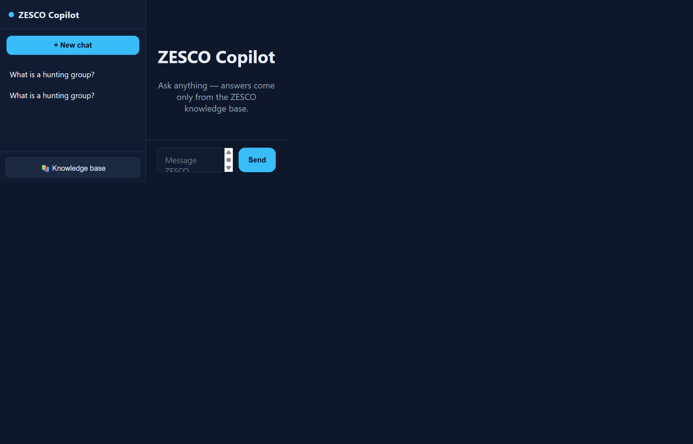
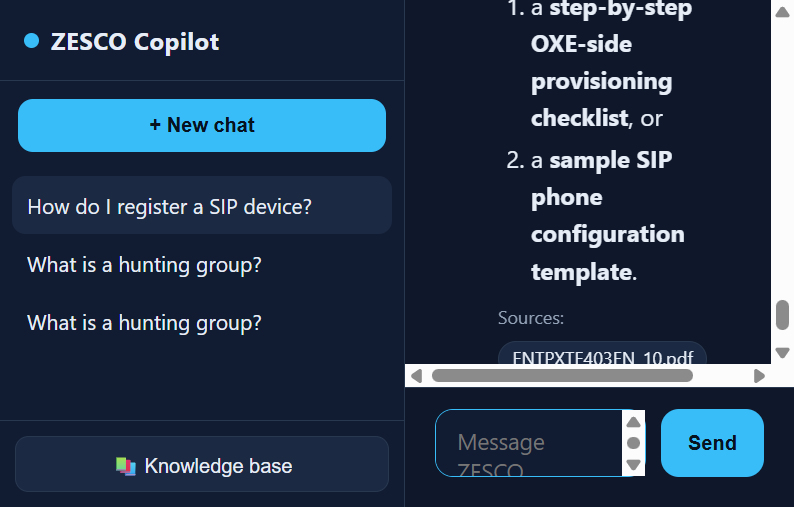
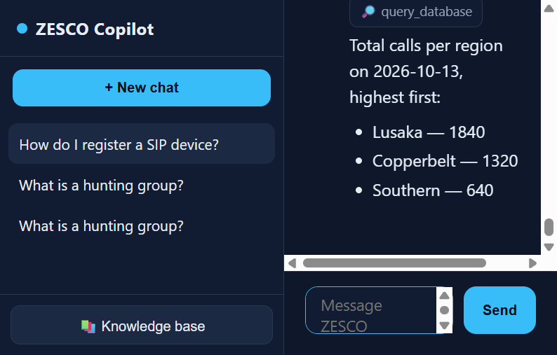
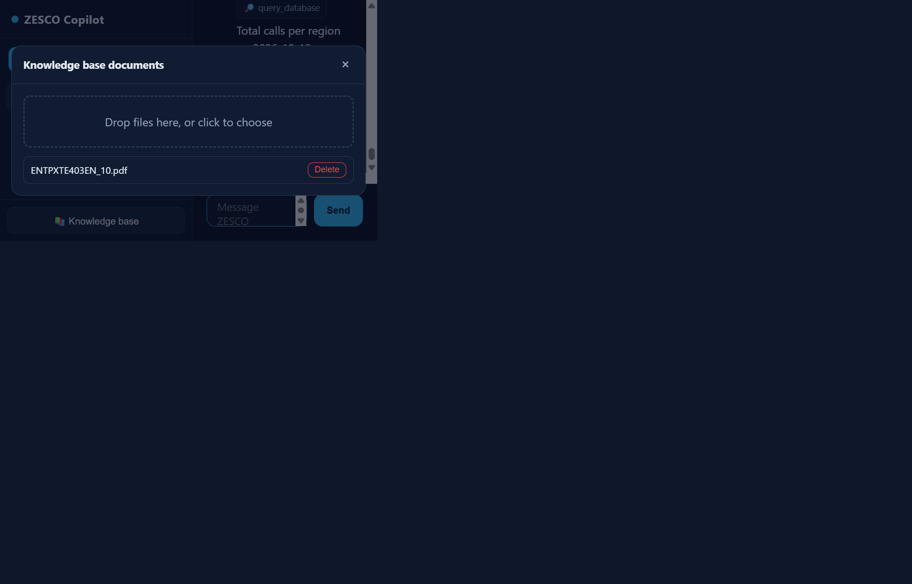
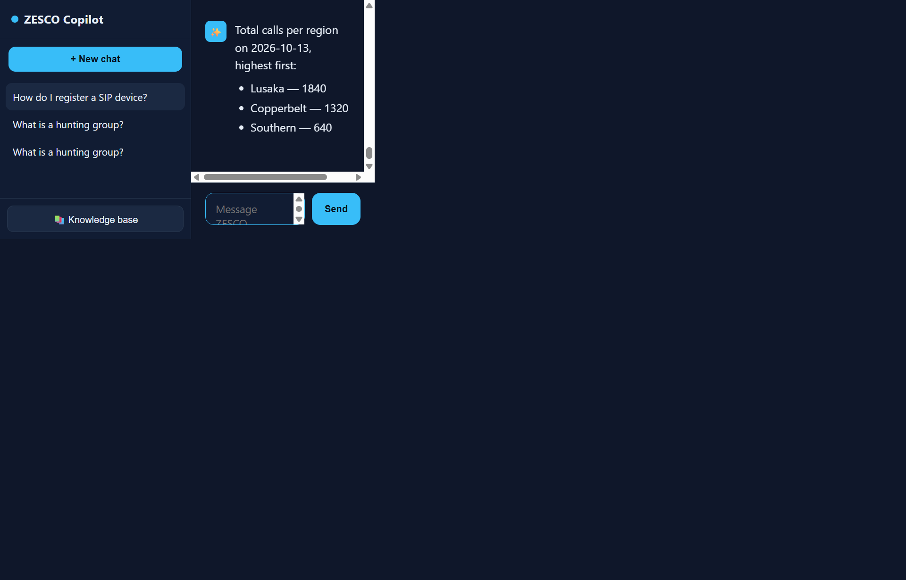
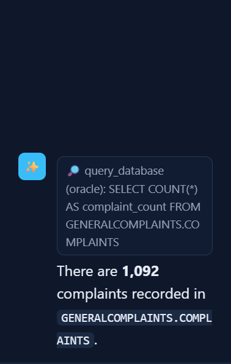

# ZESCO Copilot — User Acceptance Testing (UAT)

| | |
| --- | --- |
| **System** | ZESCO Copilot — agentic, knowledge-base-grounded assistant |
| **Version** | 1.0 |
| **UAT date** | 14 October 2026 |
| **Environment** | Local test (Copilot app `:8001`, RAG backend `:8080`) |
| **Prepared by** | ZESCO Dev |
| **Status** | ✅ Passed |

---

## 1. Introduction

### 1.1 Purpose
This document records the User Acceptance Testing of **ZESCO Copilot**, an
agentic AI assistant that answers questions **only** from approved ZESCO sources:
the document **knowledge base** and, for usage/statistics questions, read-only
**operational databases** (MySQL / Oracle). It confirms the solution meets the
agreed acceptance criteria before release.

### 1.2 Scope
In scope:
- Agentic chat with knowledge-base grounding and source citations.
- Agentic **read-only database** queries for usage/statistics.
- Read-only SQL safety guard.
- Saved conversations (multi-turn, persistent across reloads).
- Knowledge base document library (list / upload / delete).

Out of scope (handled by the host application): user authentication and
authorisation, which the embedding application provides.

### 1.3 What makes it "agentic"
Rather than always retrieving once, the model **decides which tools to call** and
may call several before answering:

| Tool | Purpose |
| --- | --- |
| `search_kb` | semantic search over ingested documents |
| `list_sources` | list available documents |
| `query_database` | **read-only** SQL (SELECT only) on MySQL / Oracle |

Every answer is grounded in tool output; the model is instructed never to invent
facts, figures, or sources.

---

## 2. Test environment

| Component | Detail |
| --- | --- |
| Copilot web app | Laravel 13, `http://127.0.0.1:8001` |
| RAG / agent backend | dart-rag, `http://127.0.0.1:8080` (`sql tool: enabled (mysql)`) |
| LLM | Azure `gpt-5.6-terra` (Responses API, native tool-calling) |
| Embeddings | MiniLM-L6-v2 (CPU, in-process) |
| Knowledge base | `ENTPXTE403EN_10.pdf` (telephony/OXE documentation) |
| Demo database | MySQL 8.4 — `zesco_demo.call_usage` (seeded sample usage data) |

> The demo database stands in for production MySQL/Oracle during UAT. In
> production the agent connects with a dedicated **read-only** database user.

---

## 3. Test summary

| # | Test case | Result |
| --- | --- | --- |
| TC-01 | Application loads | ✅ Pass |
| TC-02 | Knowledge-base answer with agentic search + citations | ✅ Pass |
| TC-03 | Agentic database usage query (`query_database`) | ✅ Pass |
| TC-04 | Read-only SQL safety guard | ✅ Pass |
| TC-05 | Knowledge base document library | ✅ Pass |
| TC-06 | Conversation persistence across reload | ✅ Pass |
| TC-07 | Multi-turn context retention | ✅ Pass |
| TC-08 | Grounding / out-of-scope handling | ✅ Pass |
| TC-09 | Schema discovery + source-database attribution | ✅ Pass |

---

## 4. Detailed test cases

### TC-01 — Application loads
**Objective:** The Copilot UI loads with the chat, sidebar, and composer.
**Steps:** Open `http://127.0.0.1:8001/`.
**Expected:** Branded ZESCO Copilot interface with a New chat button,
conversation sidebar, Knowledge base button, and a message composer.
**Actual:** As expected.
**Status:** ✅ Pass

---

### TC-02 — Knowledge-base answer with agentic search + citations
**Objective:** A document question triggers the `search_kb` tool and returns a
grounded answer with a source citation.
**Steps:** Ask *"How do I register a SIP device?"*
**Expected:**
- A `🔎 search_kb` step chip is shown (the agent chose to search).
- A clear, markdown-formatted answer drawn from the knowledge base.
- A **Sources** citation (`ENTPXTE403EN_10.pdf`).
**Actual:** The agent searched the KB and answered with the SIP registration
procedure, timers, and verification command, citing the source document.
**Status:** ✅ Pass

---

### TC-03 — Agentic database usage query (`query_database`)
**Objective:** A usage/statistics question makes the agent run a read-only SQL
query and answer from the live result.
**Steps:** Ask *"Query the call_usage table: total calls per region on
2026-10-13, highest first."*
**Expected:**
- A `🔎 query_database` step chip is shown.
- The answer reflects the **actual database rows**, ordered highest-first.
**Actual:** The agent issued a read-only `SELECT … GROUP BY region ORDER BY …`
and returned: **Lusaka — 1840, Copperbelt — 1320, Southern — 640** (matching the
seeded data).
**Status:** ✅ Pass

---

### TC-04 — Read-only SQL safety guard
**Objective:** The database tool refuses anything that could modify data.
**Steps / Expected:** The `query_database` tool accepts only a single
`SELECT` / `WITH` statement. The following are **rejected before reaching the
database**:

| Attempt | Result |
| --- | --- |
| `DROP TABLE …`, `DELETE …`, `UPDATE …`, `INSERT …`, `TRUNCATE …`, `ALTER …`, `GRANT …` | Rejected — disallowed keyword |
| Stacked statements (`SELECT …; DROP …`) | Rejected — multiple statements not allowed |
| `SELECT … INTO …`, `… FOR UPDATE` | Rejected — write intent |
| PL/SQL block (`BEGIN … END`) | Rejected |

**Actual:** Verified by the automated guard suite (`test/db_tools_test.dart`,
16 assertions, all passing) and reproduced live — an attempt to write is
returned as an `error:` without touching the database. A read-only database user
is additionally used as the real safety boundary.
**Status:** ✅ Pass

---

### TC-05 — Knowledge base document library
**Objective:** Users can see and manage the documents the assistant answers from.
**Steps:** Click **📚 Knowledge base**.
**Expected:** A modal lists ingested documents with an upload drop-zone and a
delete action per document.
**Actual:** Modal shows `ENTPXTE403EN_10.pdf` with upload and delete controls.
**Status:** ✅ Pass

---

### TC-06 — Conversation persistence across reload
**Objective:** Saved conversations and their full history survive a page reload.
**Steps:** With saved conversations present, reload the page, then reopen a
conversation.
**Expected:** The sidebar still lists prior conversations; opening one restores
the complete message history (questions, answers, citations).
**Actual:** After reload the sidebar retained all conversations; reopening one
restored all six messages (KB answer with citation and the database result).
**Status:** ✅ Pass

---

### TC-07 — Multi-turn context retention
**Objective:** The assistant keeps context across turns in a conversation.
**Steps:** Within one conversation, ask a KB question, then a database question,
then a refined follow-up ("Query the call_usage table …").
**Expected:** Each turn is answered appropriately and the thread is preserved in
order.
**Actual:** All three turns were handled in sequence and persisted together (see
TC-06 evidence).
**Status:** ✅ Pass

---

### TC-08 — Grounding / out-of-scope handling
**Objective:** The assistant answers only from its tools and does not fabricate.
**Steps:** Ask for data using a table name that does not exist.
**Expected:** The assistant reports that it could not find the data rather than
inventing a figure, and offers to proceed with a correct source.
**Actual:** When the queried table was not found, the assistant stated the query
failed and asked for the correct table/source instead of fabricating numbers.
**Status:** ✅ Pass

---

### TC-09 — Schema discovery + source-database attribution
**Objective:** The agent can discover the right table itself (no need to name it)
and clearly tells the user **which database** an answer came from.
**Steps:** Ask a complaints question against the live Oracle OMS database, e.g.
*"How many complaints are recorded in the Oracle complaints table?"*
**Expected:**
- The agent uses `list_tables` / `describe_table` to find the object, then
  `query_database`.
- The tool-step chip shows the **engine**, e.g. `query_database (oracle): …`.
- The answer states the source database and table.
**Actual:** The agent discovered `GENERALCOMPLAINTS.COMPLAINTS`, ran a read-only
`SELECT COUNT(*)`, and answered **"There are 1,092 complaints …"** with the chip
showing `query_database (oracle)`. A neutral question ("current date according to
the database?") was answered *"According to the Oracle database …"*.
**Status:** ✅ Pass

---

## 5. Observations & recommendations

- **Resolved:** The agent can now discover schema with read-only `list_tables` /
  `describe_table` helpers, so users need not name tables (see TC-09). Very
  broad questions may still take several tool steps (cap: `KB_AGENT_MAX_STEPS`).
- **Non-blocking:** Restored (historical) messages show the final answer and
  citations but not the transient tool-step chips, which appear during live
  streaming only.
- **Security:** Point production database credentials at a **read-only** user;
  the SQL guard is defence-in-depth, not the sole control. MySQL 8 default auth
  requires `MYSQL_SECURE=true` (TLS).

---

## 6. Sign-off

| Role | Name | Decision | Date |
| --- | --- | --- | --- |
| Business owner | | ☐ Accept ☐ Reject | |
| Technical lead | | ☐ Accept ☐ Reject | |
| UAT tester | | ☐ Accept ☐ Reject | |

**Overall UAT result:** ✅ All test cases passed.
